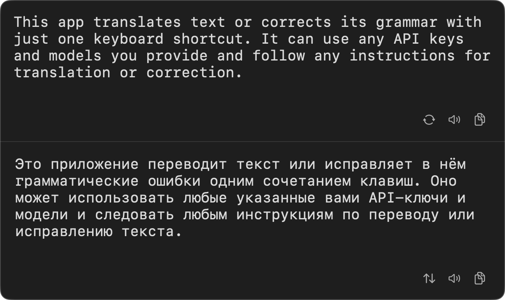
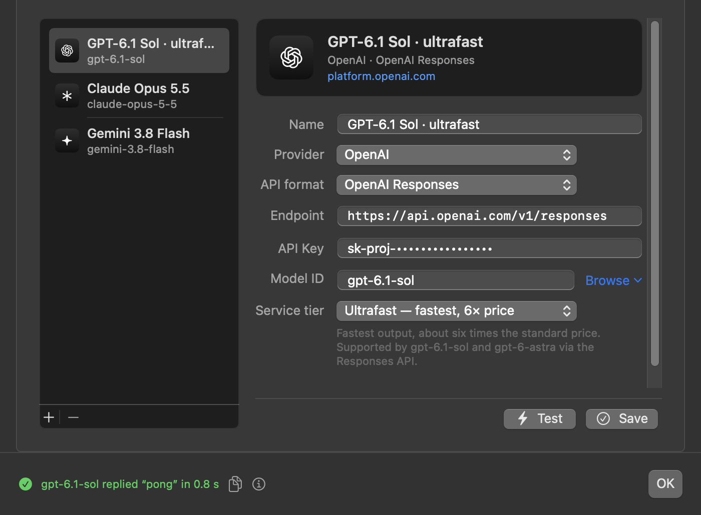
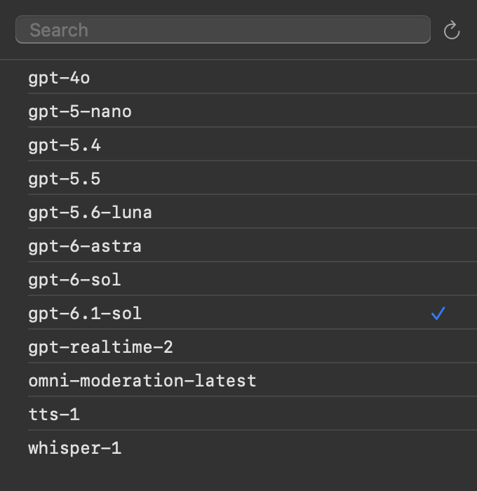
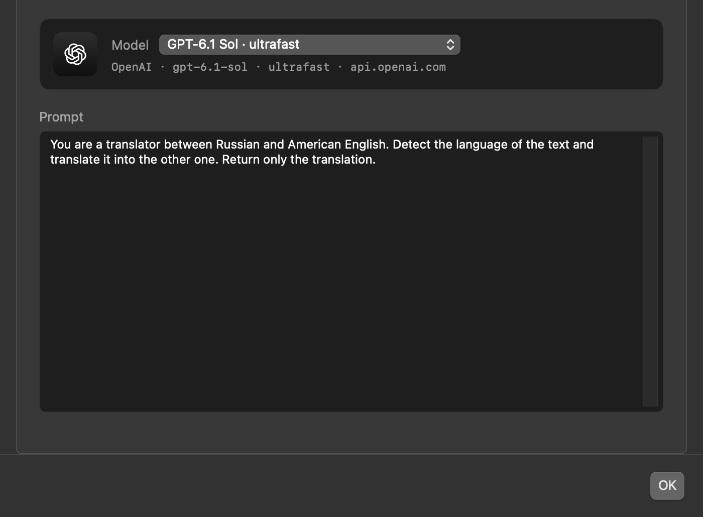

<p align="center">
  
</p>

<h1 align="center">tpopup</h1>

<p align="center">
  <b>System-Wide AI Translation, Grammar Correction & Style Polish for macOS</b><br>
  Select text in any app. Press a shortcut. Get instant translations or in-place rewrites —<br>
  with <b>zero subscriptions</b>, <b>zero background bloat</b>, and <b>zero permissions</b>.
</p>

<p align="center">
  
  
  
  
  
</p>

<p align="center">
  <a href="#-why-tpopup">Why tpopup?</a> ·
  <a href="#-three-modes-one-keystroke-each">Features & Modes</a> ·
  <a href="#-use-any-ai-model-cloud-or-local">Supported AI Models</a> ·
  <a href="#-get-started-in-3-minutes">Quick Start</a> ·
  <a href="#-privacy--native-architecture">Privacy & Architecture</a>
</p>

<p align="center">
  
</p>

---

## 💡 Stop Paying Subscriptions for a Prompt Wrapper

The internet is full of macOS translation apps, grammar checkers, and "AI writing assistants" charging **\$10 to \$30 every month** — often just to wrap an LLM API you already pay for. Meanwhile, using ChatGPT or Claude in a browser forces you into an endless focus-breaking loop: `⌘C` → `⌘Tab` → paste → type prompt → wait → copy → `⌘Tab` → `⌘V`.

**tpopup** eliminates both the subscription tax and the window-switching dance:

* **💸 Free forever, pennies to run:** Bring your own API key from OpenAI, Anthropic, Google Gemini, DeepSeek, Groq, Mistral, xAI, or OpenRouter and pay raw API rates (typically **a few cents a month**), or run **100% free and offline** using local **Ollama**.
* **⚡ Works inside every Mac app:** Slack, Apple Mail, Safari, Chrome, VS Code, Xcode, Notion, Telegram, Discord, Notes, and PDF readers. If you can select text, `tpopup` works there.
* **🪶 Truly invisible until summoned:** No Dock icon. No menu bar clutter. No background daemon eating 500 MB of RAM. It launches on your shortcut, completes the job in milliseconds, and quits completely.

---

## 📊 Why `tpopup`?

| Feature | **tpopup** | Grammarly / DeepL Pro | Paid Mac AI Wrappers | Browser ChatGPT / Claude |
| :--- | :--- | :--- | :--- | :--- |
| **Monthly Cost** | **\$0** *(pennies via API or free local LLM)* | \$12 – \$30 / month | \$10 – \$20 / month or \$50+ license | \$20 / month |
| **Workflow** | **1 shortcut (popup or in-place replace)** | Browser plugin / heavy app | Menu bar chat / floating panels | Copy → switch window → paste → copy back |
| **AI Models** | **Any** *(GPT, Claude, Gemini, DeepSeek, Ollama…)* | Locked to vendor | Limited selection | Single provider |
| **Keylogger / Accessibility Permission** | **❌ Never required** | ⚠️ Required *(reads all typing)* | ⚠️ Required | N/A |
| **Idle RAM Usage** | **0 MB** *(exits immediately after use)* | 300 – 800 MB always running | 150 – 400 MB always running | Browser tab overhead |
| **Custom Prompts** | **✅ Full control per mode** | ❌ Fixed behavior | Partial | Manual typing every time |

---

## ✨ Three Modes. One Keystroke Each.

### 1. 🌐 Instant Bidirectional Translation (<kbd>⌥</kbd><kbd>⌘</kbd><kbd>T</kbd>)

Highlight text in any app and press <kbd>⌥</kbd><kbd>⌘</kbd><kbd>T</kbd>. A clean, dark-mode HUD appears right on your screen with the original text on top and the translation below.

* **Live Source Editing:** Want to test how a different word or phrasing translates? Click directly into the top pane, edit the text, and press <kbd>⌘</kbd><kbd>↩</kbd> (or click **⟳**) to re-translate immediately.
* **Round-Trip Verification:** Press <kbd>⇧</kbd><kbd>⌘</kbd><kbd>↩</kbd> (or click **⇅**) to push the translation into the top pane and translate it back into the original language — the fastest way to verify nuance and tone before sending an important message.
* **Natural Read-Aloud:** Click **🔊** on either pane to hear the text spoken aloud. `tpopup` automatically detects the language and picks the highest-quality macOS voice installed on your system.
* **Works with Any Language Pair:** Ships with an English ↔ Russian prompt out of the box, and takes 5 seconds to customize for **Spanish, German, Japanese, Chinese, French, Portuguese, Ukrainian, Korean**, or any other language pair.

---

### 2. ✅ In-Place Grammar Correction (<kbd>⌥</kbd><kbd>⌘</kbd><kbd>G</kbd>)

Select a hasty draft, a voice-dictated note, or a quick Slack reply and press <kbd>⌥</kbd><kbd>⌘</kbd><kbd>G</kbd>.

<p align="center">
  
</p>

A sleek, Dynamic Island–style indicator briefly peeks from the top edge of your display while the model works, and **your selected text is replaced right where it sits** — no popup, no extra keystrokes.

* **Conservative by design:** Fixes grammar, typos, punctuation, and broken syntax while strictly preserving your original word choice, tone, and technical terminology.

---

### 3. 🪄 Native Style & Clarity Polish (<kbd>⌥</kbd><kbd>⌘</kbd><kbd>R</kbd>)

When correct grammar isn't enough and you want your writing to read like a sharp native editor wrote it, select your text and press <kbd>⌥</kbd><kbd>⌘</kbd><kbd>R</kbd>.

* **Rewrites in place:** Smooths out stiff or non-native phrasing, removes redundancy, and tightens sentence flow.
* **Zero data loss:** Engineered to keep 100% of your technical parameters, numbers, code identifiers, and logical premises intact. Ideal for emails, pull requests, design docs, and client communication.

---

## 🧠 Use Any AI Model (Cloud or Local)

Different tasks call for different models. With `tpopup`, you can configure multiple model profiles and assign the best one to each mode — for example, an ultra-low-latency model for instant grammar fixes and a frontier reasoning model for nuanced translations.

<p align="center">
  
</p>

### Built-In Provider Presets

| Provider | Wire Format | Speed / Service Tiers |
| :--- | :--- | :--- |
| **OpenAI** | Responses API or Chat Completions | `Standard` · `Flex` · `Fast` · `Ultrafast` |
| **Anthropic** | Messages API | `Standard` · `Fast` |
| **Google Gemini** | OpenAI-compatible | `Standard` · `Flex` · `Priority` |
| **OpenRouter** | Chat Completions *(300+ models, 1 key)* | Provider routing via JSON |
| **Groq · Mistral · DeepSeek · xAI** | Chat Completions | — |
| **Ollama (Local & Offline)** | Chat Completions *(no API key needed)* | Runs locally on Apple Silicon |
| **Custom Endpoint** | OpenAI or Anthropic format | LM Studio, vLLM, LiteLLM, corporate proxies |

### Built for Power Users

<table>
  <tr>
    <td width="50%" valign="top">
      <h4>🔎 Live Model Browser</h4>
      <p>Never hunt through API docs for exact model IDs. Click <b>Browse</b> to query your provider's live catalog with instant search and pick any model your account can access.</p>
      <p align="center">
        
      </p>
    </td>
    <td width="50%" valign="top">
      <h4>🎛️ Full Prompt Control Per Mode</h4>
      <p>Every mode has its own plain-text system prompt. Change target languages, enforce formatting rules, or repurpose a mode into a custom AI action in seconds.</p>
      <p align="center">
        
      </p>
    </td>
  </tr>
</table>

* **🚀 First-Class Speed Tiers:** Dedicated dropdown for OpenAI (`Ultrafast` / `Fast` / `Flex`), Anthropic (`Fast` mode), and Gemini (`Priority` / `Flex`), with automatic compatibility hints.
* **⚡ One-Click Latency Test:** Hit **Test** to send a live `"ping"` and verify your setup, displaying the exact round-trip time (e.g., `replied "pong" in 0.8 s`) or a copyable error diagnostic.
* **🧩 Future-Proof JSON Overrides:** Two optional JSON fields (**Extra request fields** and **Extra HTTP headers**) let you pass new provider parameters (`reasoning_effort`, `temperature`, `anthropic-beta`, org headers) on day one without waiting for an app update.

---

## 🚀 Get Started in 3 Minutes

### Step 1: Build & Install

Clone the repository and run the one-step deployment script (requires Xcode Command Line Tools / Swift 5.10+ on macOS 14+):

```sh
git clone https://github.com/igaevd/tpopup.git && cd tpopup && ./deploy.sh
```

This compiles a universal release binary (`arm64` + `x86_64`), packages the native app bundle, and installs `tpopup.app` directly into `/Applications`. *(Prefer a drag-and-drop installer? Run `./pack.sh` to build a `.dmg` in `dist/`.)*

### Step 2: Add Your AI Model

1. Open **`/Applications/tpopup.app`**.
2. In the **Models** tab, click **+**, choose your provider (or **Ollama** for local offline use), paste your API key, click **Browse** to select a model, and click **⚡ Test** to confirm it responds.
3. Switch to the **Translation**, **Grammar**, and **Style** tabs, select your model from the dropdown, adjust the prompt if desired (e.g., change the translation languages), and click **OK**.

### Step 3: Bind Your Global Shortcuts

`tpopup` integrates with native **macOS Services (Automator Quick Actions)** so it works in every app without requiring invasive Accessibility permissions.

1. Open **Automator** → **New Document** → **Quick Action**.
2. Set **Workflow receives current** to **`text`** in **`any application`**.
3. Add a **Run Shell Script** action, set **Pass input** to **`to stdin`**, and create up to three Quick Actions:

| Quick Action Name | "Output replaces selected text" | Shell Script | Recommended Shortcut |
| :--- | :---: | :--- | :---: |
| **Translation Popup** ([full guide](docs/quick-action-translation.md)) | ❌ Unchecked | <code>cat &#124; LANG=en_US.UTF-8 pbcopy</code><br><code>open -a /Applications/tpopup.app --args -translate</code> | <kbd>⌥</kbd><kbd>⌘</kbd><kbd>T</kbd> |
| **Grammar Correction** ([full guide](docs/quick-action-grammar.md)) | ✅ **Checked** | <code>cat &#124; LANG=en_US.UTF-8 pbcopy</code><br><code>/Applications/tpopup.app/Contents/MacOS/tpopup -grammar</code> | <kbd>⌥</kbd><kbd>⌘</kbd><kbd>G</kbd> |
| **Style Polish** ([full guide](docs/quick-action-style.md)) | ✅ **Checked** | <code>cat &#124; LANG=en_US.UTF-8 pbcopy</code><br><code>/Applications/tpopup.app/Contents/MacOS/tpopup -style</code> | <kbd>⌥</kbd><kbd>⌘</kbd><kbd>R</kbd> |

4. Assign your keyboard shortcuts in **System Settings → Keyboard → Keyboard Shortcuts → Services → Text**.

That's it! Select text anywhere on your Mac and press your shortcut.

---

## 🔒 Privacy & Native Architecture

Most macOS productivity utilities demand **Accessibility** or **Input Monitoring** permissions so they can simulate `⌘C` / `⌘V` keystrokes and monitor your screen. Granting those permissions gives an app the ability to log every keystroke you type across your entire system.

**tpopup is architected differently:**

* **Zero macOS Permissions:** By leveraging native macOS Services (`stdin` → `tpopup` → `stdout`), the operating system hands only your explicitly selected text to `tpopup` and replaces it cleanly when you trigger a shortcut. No simulated keystrokes, no screen recording, no permission dialogs.
* **Direct-to-Provider Requests:** Your API keys are stored locally in your macOS user defaults. Requests go straight from your Mac to the API endpoint you configured. There is no middleman server, no account signup, and zero analytics or telemetry.
* **Pure Swift & Zero Dependencies:** Built strictly with native Apple frameworks (`AppKit`, `SwiftUI`, `AVFoundation`, `NaturalLanguage`). The entire compiled app is ~250 KB.

---

## 🛠️ Tips & Customization

<details>
<summary><b>🌍 How to change the translation languages (e.g., Spanish, German, Japanese, French)</b></summary>
<br>

Open `tpopup.app`, go to the **Translation** tab, and edit the prompt text box. For example:

```text
You are a professional translator between Spanish and American English. Detect the language of the input text and translate it into the other language. Preserve tone, idioms, and technical terms. Output ONLY the final translated text.
```

You can also instruct it to translate *any* foreign language into your native language, while translating your native language into English!
</details>

<details>
<summary><b>⌨️ Keyboard shortcuts inside the Translation Popup</b></summary>
<br>

| Shortcut | Action |
| :--- | :--- |
| <kbd>Esc</kbd> | Close the popup window |
| <kbd>⌘</kbd><kbd>↩</kbd> | Re-translate after editing the source text in the top pane |
| <kbd>⇧</kbd><kbd>⌘</kbd><kbd>↩</kbd> | Swap: move the translation into the top pane and translate it back |
</details>

<details>
<summary><b>🔊 Enabling studio-quality macOS voices for Read-Aloud</b></summary>
<br>

macOS includes neural voices that sound remarkably natural, and `tpopup` automatically selects the best installed voice for the detected language:

1. Open **System Settings → Accessibility → Read & Speak**.
2. Click the **ⓘ** button next to **System Voice**.
3. Search for your target languages and download a voice labeled **Premium** or **Enhanced** *(Siri does not need to be enabled)*.
</details>

<details>
<summary><b>⚙️ Advanced JSON request fields & headers</b></summary>
<br>

In the **Models** tab, you can customize raw API payloads per model profile:

* **Extra request fields:** JSON merged into every request body (overrides defaults, including the speed tier picker).
  * Example: `{"reasoning": {"effort": "low"}, "max_tokens": 4000}`
* **Extra HTTP headers:** JSON object sent as HTTP headers with every request.
  * Example: `{"OpenAI-Organization": "org_...", "HTTP-Referer": "https://github.com/igaevd/tpopup"}`
* Default system prompts live in `resources/*.md` if you want to customize them before building from source.
</details>

<details>
<summary><b>📦 Building a distributable DMG & upgrading from v1.x</b></summary>
<br>

* **Build DMG & ZIP:** Run `./pack.sh` to create `dist/tpopup-<version>.dmg` and `dist/tpopup-<version>.zip` (version is read from `BundleResources/Info.plist`).
* **Upgrading from v1.x:** Your existing per-mode OpenAI API key and model settings are automatically migrated into v2.0 model profiles on first launch.
</details>

---

<p align="center">
  <b>100% Free & Open Source. No subscriptions, no telemetry, no strings attached.</b><br>
  If <code>tpopup</code> saves you from a monthly subscription or a browser tab switch today, please give the repo a ⭐!
</p>
